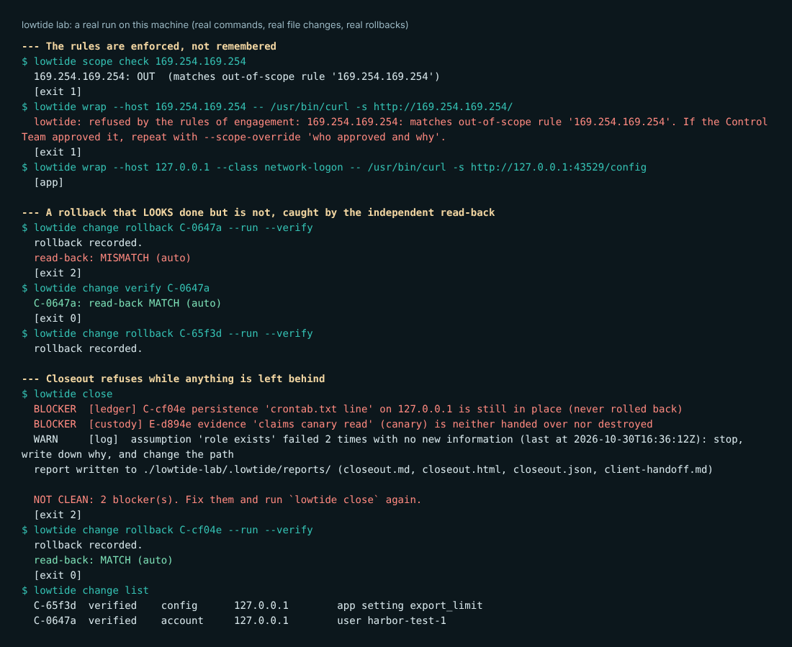

<p align="center">
  <picture>
    <source media="(prefers-color-scheme: dark)" srcset="assets/logo-dark.svg">
    
  </picture>
</p>

<p align="center">
  <b>A change ledger, rollback verifier and control-team kit for red team engagements.</b><br>
  Every change is written down before you make it. Nothing counts as undone until the state is read back and matches.
</p>

<p align="center">
  
  
  
  
</p>

---

## The problem

Red team tools are good at recording what you **did**. Almost none check that you **undid** it.

At the end of an engagement the account you created, the scheduled job you added, the setting you changed and the key you were handed are all
somewhere. Most teams find them with a spreadsheet and a good memory. When the blue team notices you, the questions get harder: what is still running
with no operator? what can responders find next? who is allowed to decide what happens now?

Lowtide keeps that record, enforces the rules of engagement while you work, and **refuses to close the engagement until everything is undone and proved undone.**

```
$ lowtide change rollback C-0647a --run --verify
  rollback recorded.
  read-back: MISMATCH (auto)          <- the rollback said "done"; the state said otherwise
$ lowtide close
  BLOCKER  persistence 'crontab.txt line' is still in place (never rolled back)
  NOT CLEAN: 2 blocker(s).
```

## See it work in two minutes

```bash
pip install git+https://github.com/1337exe/lowtide
lowtide selftest      # 13 checks, including a live lab on your machine
lowtide lab           # watch real commands, real changes and real rollbacks, step by step
lowtide demo          # read a finished (made-up) engagement
```

<p align="center"></p>

## How it works

<p align="center"></p>

Everything is rebuilt from one append-only journal. Each operator writes their own file, each line carries the hash of the line before it, and nothing is ever edited.
State, reports and the closeout check are replayed from it, so two operators on one engagement never disagree about what is open.

## What it does

| | |
|---|---|
| **Change ledger** | Record a change with its original value *before* you make it. Lowtide can capture that value itself and read it back later, so the check is done by the tool, not by your memory. |
| **Verified rollback** | A rollback only counts when a read-back matches the original. Read-backs have a strength (`auto`, `manual`, `attested`), and you can require a second operator. |
| **Rules of engagement as code** | Scope, testing window and forbidden actions are checked on every command. A host that is not listed is refused, not guessed. Overrides are allowed, in writing, and appear in the report. |
| **Credential containment** | Each credential family has its own cleanup steps and token lifetime. Tokens you already issued stay valid, so closeout waits for that window (or for someone to accept it in writing). |
| **Freeze, stop, SITREP** | One command stops operator activity and lists everything still running with no operator, taken from the ledger. SITREPs are built from the operator log, not from memory. |
| **Control Team split** | The red team recommends; only named Control Team members can decide or resume. Tripwires (contacting outside parties, touching production response) need a recorded decision first. |
| **Evidence custody** | Hashes, a sensitivity ladder (authority, metadata, canary, real record), canary proof by digest, handoff and destruction records. |
| **Purple review** | Join your log with the client's alert timeline in UTC: what was seen, how fast, what was missed, and blue events you never logged. Export an ATT&CK Navigator layer coloured by what blue saw. |
| **Closeout gate** | Refuses until the ledger, credentials, custody and stop conditions are clean. Writes an HTML/Markdown/JSON report, a client handoff list, a seal and a pack anyone can verify. |
| **Price table** | 32 action classes: what each leaves behind and where it is recorded. A starting point for the three questions before you act. |
| **Fits your tools** | Cobalt Strike log import, Ghostwriter import and export, CSV/JSONL, Markdown export, `wrap` for any command. |
| **MCP server** | Lets an AI agent follow the same rules. It can log and check; it cannot waive, decide, resume or run shell commands. |

It has **no dependencies** and makes **no network connections**.

## Use it on a real engagement

```bash
mkdir acme-2026 && cd acme-2026
lowtide init --name ACME-RT --client "Acme Corp"
$EDITOR .lowtide/scope.json          # targets, window, forbidden actions, the Control Team's names
export LOWTIDE_OPERATOR=alice

lowtide scope check ws1.acme.example
lowtide wrap --host ws1.acme.example -- ./my-tool --args
lowtide change add --kind config --host app1.acme.example --object "export_limit" --change "100 -> 5000" \
    --capture "cat /etc/app/app.ini" --rollback-cmd "cp /root/app.ini.orig /etc/app/app.ini"
# ... make the change ...
lowtide change rollback C-1a2b3 --run --verify
lowtide close
```

Full walk-through: [docs/getting-started.md](docs/getting-started.md). Day-to-day: [operator guide](docs/operator-guide.md). For the people who own the engagement for the client: [Control Team guide](docs/control-team.md).

### Plug it into what you already run

| You use | Do this |
|---|---|
| Cobalt Strike | `lowtide import cobalt-strike beacon_123.log --year 2026 --host ws1.acme.example` |
| Ghostwriter | `lowtide import ghostwriter oplog.csv` and `lowtide export ghostwriter` |
| Any C2 or script | `lowtide wrap --host H -- <command>` or import its export as CSV |
| The client's SIEM | `lowtide review blue.csv` and `lowtide navigator blue.csv` |
| An AI agent | `claude mcp add lowtide -- lowtide mcp --home .lowtide --operator agent-1` ([guide](docs/mcp.md)) |
| CI | the closeout gate as a GitHub Action ([guide](docs/ci-cd.md)) |
| An air-gapped box | copy the wheel; no dependencies ([guide](docs/offline.md)) |

More detail and examples: [docs/integrations.md](docs/integrations.md).

## Case studies

Two kinds, labelled honestly: what we **studied** and what it became, and what we **measured** by running the tool.

**1. "The beacon goes quiet on day 38." Studied:** a public, fictional decision exercise on handling a detected red team engagement
([gikaku.net](https://gikaku.net/2026/10/25/red-team-engagement-detected/)). Its lessons are freeze first, diagnose second; list what keeps running with no operator;
base the report on operator logs; the red team recommends and the Control Team decides. **Became:** `freeze`, the autonomous list taken from the ledger, `sitrep --based-on`,
`recommend` / `decide`, stop conditions, tripwires.

**2. "The rollback said done." Measured:** in the live lab, an account was created in two files and the stored rollback command fixed only one.
`change rollback --run --verify` returned `MISMATCH` and closeout stayed blocked until the second file was fixed. Nothing in the operator's own log would have shown it.

**3. "Out of scope by one address." Measured:** in the lab, a command aimed at `169.254.169.254` (listed out of scope) was refused before it ran and nothing was logged as done.
The same check blocks an unlisted host, a date outside the window and a forbidden action class.

**4. "The role was reverted but the control stayed." Studied:** a public write-up on GCP privilege paths
([gikaku.net](https://gikaku.net/2026/10/17/gcp-red-team-08/)): rolling a role back removes the temporary state but not the grant that let you change it.
**Became:** `change rollback --durable "..."`, which lands in the closeout report and the client handoff list.

**5. "Three clocks on one credential." Studied:** a public write-up on credential movement across cloud projects
([gikaku.net](https://gikaku.net/2026/10/24/gcp-red-team-09/)): the key file, the issued token and the permission each end differently, and disabling a key does not cancel tokens already issued.
**Became:** credential families with their own containment steps, a token window computed from the latest possible issue time, and a closeout that waits for it.

**6. "The joint review." Demo (made-up data):** `lowtide demo` builds a fictional engagement with a blue timeline. `lowtide review` shows which action the EDR caught within 12 minutes,
which actions nobody saw, and a blue event no red action explains. `lowtide navigator` turns it into an ATT&CK layer.

**7. "The agent that tried an out-of-scope host." Measured:** in the test kit an MCP client asked to log an action against an unlisted host and got a refusal with the reason, not a silent success.

**8. "A log that only has wins." Studied:** public OPSEC write-ups
([gikaku.net](https://gikaku.net/2026/10/17/crto-opsec/)) warn that a log recording only successes cannot be checked. **Became:** closeout warns after ten actions with no recorded failure,
and warns when the same assumption fails twice with nothing new learned.

**9. "Two operators, one machine." Measured (local drill, Linux):** [`drills/local-two-operator`](drills/local-two-operator) (`python drill.py`, Linux or Windows) runs two operators and a Control Team against a real local web app, a real listener
and, with `--system`, a real local user account, all on `127.0.0.x`. A small stand-in detector (three rules, written for the drill; it is not a SIEM) plays blue. One run produced:
5 actions, 2 seen by blue (the new user, L3 after a staged escalation; the new listener, L1) and 3 not seen (two config calls, one hosts-file edit on a host blue did not watch);
an out-of-scope command refused before it ran; a command refused while frozen;
a repeated-assumption warning on the second failure; an incomplete rollback caught by the second operator's read-back (`MISMATCH`, exit 2) and fixed; a closeout that came back clean only after every read-back matched;
and a pack that verified. With `--system`: 6 actions, 3 seen (L1, L2, L3), the real account added and removed, `CLEAN`.
The drill ran the same way on Windows 11 (Python 3.12): 13 of 13 checks as expected and 2 of 5 actions seen, as on Linux (the detector was slower there: the listener alert came 6 s after the action instead of 0 s). The drill (with its first Windows run) also found three bugs in Lowtide, now fixed with tests: `wrap` stamped an action when it finished instead of when it started, `review` credited one alert to every earlier action, and `review` treated two different IP addresses with the same first number as the same host.
This is a drill on one machine, not a live engagement.

**10. "GOAD-shaped replay." Synthetic (not run on GOAD):** [`drills/goad-replay`](drills/goad-replay) replays a made-up log and a blue timeline in the Windows Security-log export format
(event IDs 4625, 4720, 4726), with host names from GOAD's published layout. Result: 3 of 8 actions seen (a wrong-password logon, the test user's creation at L3 after a SOC ticket, its removal), 5 not seen,
and one blue event no action explains. It found one more bug, now fixed: `review` ignored failed attempts, so the wrong-password logon looked like blue activity with no cause. A run on the real range is still to do.

**11. "Real Windows events, synthetic operator." Measured on public data:** [`drills/evtx-replay`](drills/evtx-replay) fetches three small files from the public EVTX-ATTACK-SAMPLES set (real Security events: account creation 4720,
logons 4624 and 4625, group enumeration 4798 and 4799) and converts them to Lowtide's blue timeline. The operator log beside them is made up to match the timestamps. Result: 5 of 6 actions seen (all at L0, raw telemetry), one not seen.
It showed that the blue-timeline format works on real exported Windows events and what a real computer-account creation (event 4720) looks like to the review. It is not GOAD and not a live engagement.

## What was measured

- **63 unit tests** and the test kit pass on Python 3.10, 3.11, 3.12 and 3.13 (Linux). On a Windows 11 PC with Python 3.12, 60 of 61 tests passed (1 skipped) and test-kit steps 1 to 12 passed; the live lab needs a POSIX shell and is skipped there.
- The local drill gave the same result on a second Linux machine (Ubuntu, Python 3.10.12).
- **Test kit** (`lowtide selftest`): 13 checks, the last being the live lab. **Lab:** 45 commands against a local web app, 0 unexpected results.
- It caught, in the lab: an out-of-scope request, an incomplete rollback, a forgotten persistence entry, evidence left uncollected, a decision attempted by the wrong person,
  and an edit to the journal (`verify` exits 3). The test kit also checks that a tampered pack fails verification.
- Appending an event stays fast on large journals (3,000 events in about one second); rebuilding state from 3,000 events takes about 0.05 s.

**What it has not had:** a live client engagement, or a run on a full Active Directory range such as GOAD. It was built from public write-ups and tested in the lab. If you try it on real work and something is wrong or missing, please open an issue.

## Limits, said plainly

- **Tamper-evident, not tamper-proof.** Someone who can rewrite the whole journal and recompute every hash can forge it. Close the gap by signing: `lowtide close --gpg-key KEYID` signs the seal with gpg
  (`lowtide verify-pack` checks it against the verifier's own keyring), `LOWTIDE_KEY` adds an HMAC, and you can sign `seal.json` with `ssh-keygen -Y sign` yourself. Keep the key away from the journal.
- **Secret detection finds common shapes** (keys, tokens, passwords). It cannot know your own formats; use `--secret`.
- **The price table is a starting point.** It comes from public audit documentation; audit policy differs by site. Confirm each row in your own lab.
- **`--capture`, `--rollback-cmd` and `wrap` run commands through your shell.** The MCP server never does.
- **Importers:** Cobalt Strike (`[input]` and `[error]` lines; formats differ a little between versions, so use `--dry-run` first), Ghostwriter, and any CSV or JSONL export through `--map NAME=COLUMN`.
  There is no dedicated Sliver or Mythic parser yet; it needs real, scrubbed samples. Send one and it can be added.
- **Platforms:** built on Linux and also run on Windows (tests and test kit; see below). The live lab needs a POSIX shell and is skipped on Windows. Windows has had much less use than Linux; the Windows CI job is marked experimental.
- **Not yet tested** in a full range (such as GOAD) or on a live client engagement. See [docs/validation.md](docs/validation.md) for how to test it yourself, and what we would most like to hear back.
- Lowtide **scans nothing, exploits nothing and evades nothing.** It records, checks and refuses. Use it only on systems you are authorised to test.

## Related tools

[Ghostwriter](https://github.com/GhostManager/Ghostwriter) (operation logs and reporting), [RedELK](https://github.com/outflanknl/RedELK) (red team infrastructure logging),
[VECTR](https://github.com/SecurityRiskAdvisors/VECTR) (purple team tracking), [opseclint](https://docs.rs/crate/opseclint/1.2.0) (scores how noisy a command is),
[GCP-IAMGraph](https://github.com/Parakh-Shinde/GCP-IAMGraph/releases) (cloud IAM paths). Lowtide does not replace them. It records the thing they do not: whether you undid it. Our search for an existing tool that
gates closeout on read-back was not exhaustive. If we missed one, tell us.

The control-team and ledger ideas draw on the public write-ups of HE WEI (ギカク) at [gikaku.net](https://gikaku.net/). Lowtide is not affiliated with any of the projects above.

## Docs

[Getting started](docs/getting-started.md) · [Operator guide](docs/operator-guide.md) · [Control Team guide](docs/control-team.md) · [Integrations](docs/integrations.md) ·
[MCP](docs/mcp.md) · [Testing it yourself](docs/validation.md) · [CI/CD](docs/ci-cd.md) · [Offline](docs/offline.md) · [Reference](docs/reference.md) · [Security](SECURITY.md) · [Contributing](CONTRIBUTING.md) · [Changelog](CHANGELOG.md)

MIT licence.
